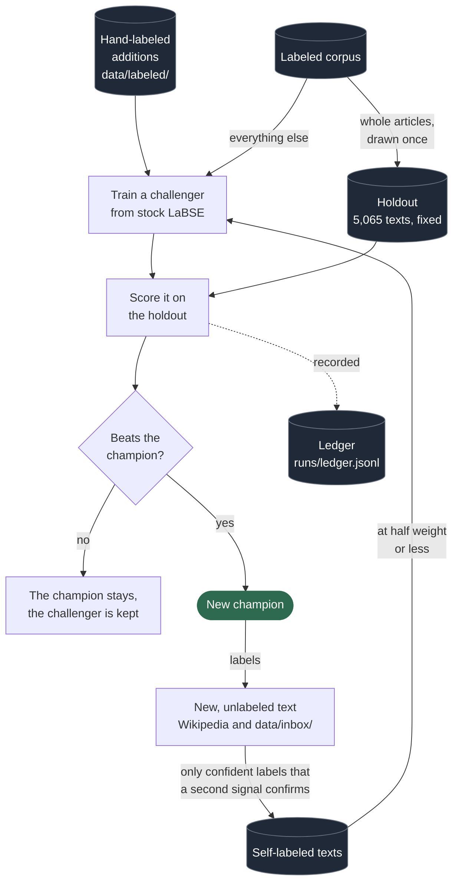
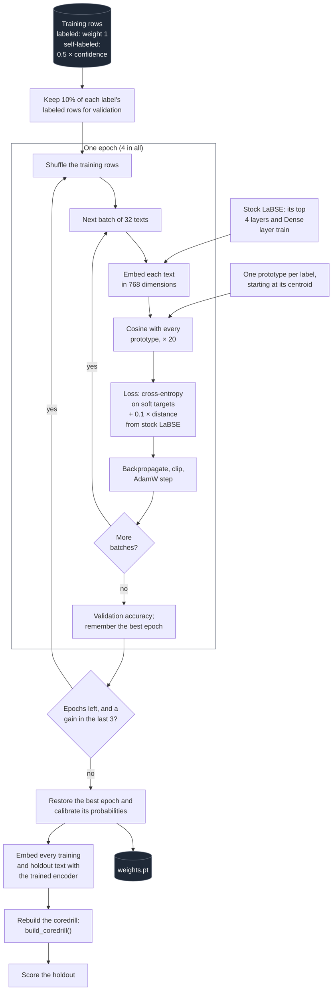
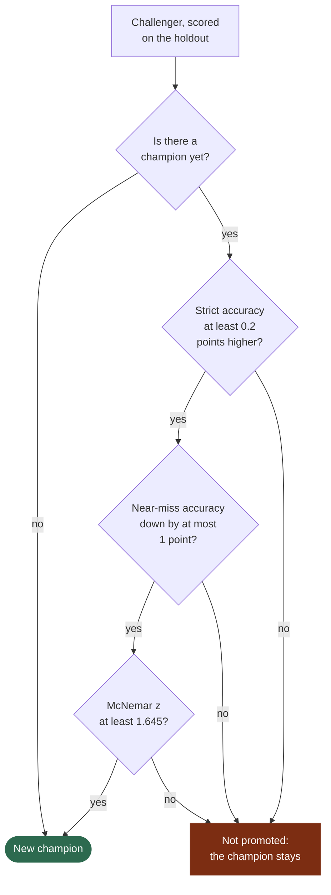
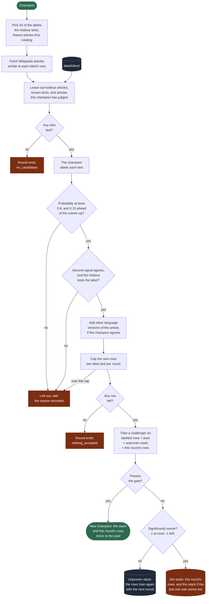
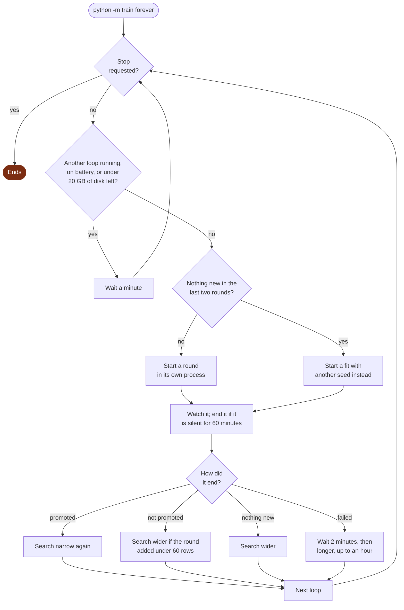

# Embedding Rhizome Classifier

Geometry-native multilingual text classification over a hand-built rhizomatic taxonomy (251 nodes).

Coredrill maps any text, in any of the 109 languages supported by LaBSE, to a position inside a hand-built semantic taxonomy - without a trained softmax classifier and without labelled inference. Classification is a matrix-vector product against a set of stored centroids, so the same multilingual manifold serves every supported language.

Full paper: [`docs/study_v5.md`](docs/study_v5.md) - *Geometry-Native Text Classification via High-Dimensional Embedding Space Analysis*

Held-out evaluation, including which of the paper's numbers hold up: [`docs/evaluation.md`](docs/evaluation.md). In short, over 199 classes the deployed pipeline gets 48% of held-out texts exactly right and 73% right or one taxonomy step away; a logistic regression on the same embeddings gets 61% and 84%. On Wikipedia articles neither has seen, both lose about 20 points.

Diagrams of the deployment topology, the offline build pipeline, the request
flow, and the taxonomy's multi-parent structure: [`docs/architecture.md`](docs/architecture.md)

Flowcharts of the training loops: [Training](#training)

---

## What it does

Instead of predicting a single label, Coredrill measures how a piece of text activates every semantic territory in the taxonomy at once. Each taxonomy node has:

- a **centroid**, the center of a semantic territory;
- a **dispersion estimate** (sigma), the territory's radius or spread;
- **parent links**, defining a six-level taxonomy from broad domains down to specific actions.

The output is a **rhizome profile**: the territories a text activates, their relative intensities, their full taxonomy paths, and a topological flow classification (Territorialization, Deterritorialization, Line of Flight, BwO Approach, Reterritorialization).

The human-readable API output reconstructs coherent rhizome areas from the taxonomy parent map. For example, a sentence about natural selection can activate both the biological chain and a secondary family-planning neighborhood:

```text
This text is mainly distributed across 2 coherent rhizome areas:
  1) Life & Biology: Life & Biology -> Biology -> Genetics -> DNA Inheritance -> Genes, with nearby signals Adaptation, Evolution, Natural Selection.
  2) Social Relations: Social Relations -> Family Life -> Family Discussion -> Family Planning Talk.
Final recommendation: Genes.
```

---

## How it works

Winner selection uses a Gram-inverse topological score. For each candidate node *i*:

```text
R_i = alpha_i * s_i * NS_i * PC_i * SW_i * sqrt(mass_i)
```

- **alpha** - oblique projection of the query onto the centroid frame (`G⁺s`, where `G` is the Gram matrix of all centroids). This removes redundancy between correlated nodes so near-duplicate centroids don't both "win" for the same reason.
- **s** - cosine proximity between the query and the node centroid.
- **NS** - neighborhood support: do this node's semantic peers (same level, correlated) also score it well?
- **PC** - path coherence: do the node's ancestors in the taxonomy agree with it, or is this an orphaned signal?
- **SW** - specificity weight: tighter, better-calibrated centroids (lower sigma) are preferred over diffuse ones.
- **sqrt(mass)** - damps nodes the text sits far from, even if they pass the other checks.

The full derivation and the experiments that led to this formula are in [`docs/study_v5.md`](docs/study_v5.md).

The approach originated from an earlier cross-lingual alignment study - a Spanish↔Russian literary corpus used to test whether embedding-space geometry alone is enough to align meaning across languages - described in the same paper.

---

## Taxonomy structure

| Level | Name | Example nodes | Count |
|---|---|---|---:|
| L0 | Branch | Natural World, Human Activity & Society | 4 |
| L1 | Domain | Life & Biology, Work & Economy, Technology | 15 |
| L2 | Discipline / territory | Medicine, Customer Service, Music | 52 |
| L3 | Topic | Diagnosis, Complaint Handling, Cosmology | 94 |
| L4 | Scenario | Doctor Appointment, Double Charge Complaint, Natural Selection | 54 |
| L5 | Action / fine node | Request, Complain, Clarify, Genes | 32 |

The taxonomy parent map is stored in `api/taxonomy.py`: 251 nodes, each with one parent. The API uses it to reconstruct full human-readable paths such as `Life & Biology -> Biology -> Genetics -> DNA Inheritance -> Genes`. The live Space's coredrill 4.0 was built from an earlier 238-node version, before the Technology branch, Epidemiology, Public Health, Pharmacology and Jurisprudence were added.

---

## Live API

The API runs on a private Hugging Face Space. To request access, contact the author.

**Base URL:** `https://lcapy-coredrill.hf.space`
**Interactive docs:** `https://lcapy-coredrill.hf.space/docs`

Hosting stays on the Hugging Face Space for now. [`infra/`](infra/README.md)
holds a Terraform design for a single EC2 instance; it has not been applied.

---

## Endpoints

| Method | Path | Description |
|---|---|---|
| GET | `/health` | Liveness check; reports loaded nodes and model. |
| GET | `/info` | Taxonomy structure, version, and skip-node list. |
| POST | `/predict` | Classify one text; returns JSON. |
| POST | `/predict/text` | Classify one text; returns human-readable terminal output. |
| POST | `/predict/batch` | Classify up to 64 texts in one request. |
| POST | `/predict/file` | Upload a `.txt` file; returns JSON. |
| POST | `/predict/file/text` | Upload a `.txt` file; returns human-readable output. |
| GET | `/taxonomy/nodes` | List all nodes, optionally filtered by level. |
| GET | `/taxonomy/node/{name}` | Node detail: sigma, n, source counts. |

---

## Quick start

### Classify a text: JSON response

```bash
curl -X POST https://lcapy-coredrill.hf.space/predict \
  -H "Authorization: Bearer YOUR_TOKEN" \
  -H "Content-Type: application/json" \
  -d '{"text": "The central bank raised interest rates by 50 basis points to combat inflation."}'
```

### Classify a text: human-readable response

```bash
curl -X POST https://lcapy-coredrill.hf.space/predict/text \
  -H "Authorization: Bearer YOUR_TOKEN" \
  -H "Content-Type: application/json" \
  -d '{"text": "Natural selection acts on heritable variation, favoring traits that increase reproductive fitness."}'
```

### Upload a text file

```bash
curl -X POST https://lcapy-coredrill.hf.space/predict/file/text \
  -H "Authorization: Bearer YOUR_TOKEN" \
  -F "file=@mytext.txt"
```

---

## Python example

```python
import json
import urllib.request

url = "https://lcapy-coredrill.hf.space/predict"
token = "YOUR_TOKEN"

text = "I was charged twice for the same order and I want a full refund."

body = json.dumps({"text": text}).encode("utf-8")

req = urllib.request.Request(
    url,
    data=body,
    headers={
        "Content-Type": "application/json",
        "Authorization": f"Bearer {token}",
    },
)

with urllib.request.urlopen(req) as response:
    result = json.loads(response.read())

print(result["best_node"])
print(result["lineage"])
print(result["active_overlap"])
```

---

## Batch prediction

```python
import json
import urllib.request

token = "YOUR_TOKEN"

body = json.dumps({
    "texts": [
        "The patient presents with lower back pain radiating to the left leg.",
        "Kant argued that synthetic a priori knowledge is possible.",
        "I would like to dispute this charge on my credit card.",
    ]
}).encode("utf-8")

req = urllib.request.Request(
    "https://lcapy-coredrill.hf.space/predict/batch",
    data=body,
    headers={
        "Content-Type": "application/json",
        "Authorization": f"Bearer {token}",
    },
)

with urllib.request.urlopen(req) as response:
    results = json.loads(response.read())

for item in results["results"]:
    print(item["best_node"], item["lineage"])
```

---

## Example output

For the text:

```text
Natural selection acts on heritable variation, favoring traits that increase reproductive fitness.
```

Coredrill returns a rhizome profile like:

```text
========================================================================
COREDRILL  -  RHIZOME PROFILE
========================================================================
  Natural selection acts on heritable variation, favoring traits that...

  This text is mainly distributed across 2 coherent rhizome areas:
    1) Life & Biology: Life & Biology -> Biology -> Genetics -> DNA Inheritance -> Genes, with nearby signals Adaptation, Evolution, Natural Selection.
    2) Social Relations: Social Relations -> Family Life -> Family Discussion -> Family Planning Talk.
  Final recommendation: Genes.

  GRAM-INVERSE  score = alpha * cos * NS * PC * SW
  winner: Genes
  NODE                             score     cos  sigma      z      lap      gau      man    MASS
  ----------------------------------------------------------------------------------------
  Genes                          +0.0217  0.5096 0.3188   1.54s  -1.5384  -1.1833  -1.4048   52.5% <<
  Genetics                       +0.0216  0.5034 0.3213   1.55s  -1.5457  -1.1946  -1.4134   48.3%
  DNA Inheritance                +0.0215  0.5042 0.3202   1.55s  -1.5485  -1.1989  -1.4159   47.1%
  Ecology                        +0.0213  0.5018 0.3394   1.47s  -1.4679  -1.0773  -1.3386   99.2%
  Ecosystems                     +0.0213  0.5032 0.3386   1.47s  -1.4674  -1.0766  -1.3377  100.0%

  RECOMMENDED: Genes  (level 5)

  CLADISTIC PATH:
  Natural World -> Life & Biology -> Biology -> Genetics -> DNA Inheritance -> Genes

  PRIMARY FLOW: BwO APPROACH
========================================================================
```

(Illustrative sample - exact scores shift as the taxonomy and scoring weights are tuned.)

The summary is taxonomy-backed: the API does not merely print the top-ranked isolated nodes. It reconstructs full parent chains from `api/taxonomy.py`.

---

## Multilingual support

The same taxonomy applies across all LaBSE-supported languages. Tested languages include Portuguese, Spanish, Russian, Japanese, German, French, Korean, Hebrew, Vietnamese, Arabic, Chinese, and English - with no per-language configuration.

---

## Project structure

```text
embedding-rhizome-classifier/
├── .github/
│   └── workflows/
│       └── keep_alive.yml      # pings the HF Space so it doesn't sleep
├── api/
│   ├── __init__.py
│   ├── app.py                  # FastAPI application
│   ├── align_ui.py             # Gradio text-alignment page at /align
│   ├── alignment_engine.py     # segmentation and LaBSE alignment for /align
│   └── taxonomy.py             # 251-node taxonomy parent map
├── docs/
│   ├── architecture.md         # deployment, build pipeline, request flow
│   ├── evaluation.md           # held-out evaluation
│   ├── free_deployment.md      # deployment guide
│   ├── study_v5.md             # full research paper
│   └── training.md             # the training loop
├── eval/
│   └── held_out/               # held-out evaluation scripts and result JSONs
├── infra/                      # Terraform for a single-EC2 option (not applied)
├── scripts/
│   ├── rhizome_engine.py       # core engine: collect / embed / build / predict
│   ├── build_sentences.py      # multi-label sentence dataset builder
│   ├── collect_medical.py      # targeted medical data collection
│   ├── collect_tech_medical.py # Wikipedia data for the newer nodes
│   └── predict_folder.py       # batch prediction and A/B comparison
├── tests/
│   ├── run_eval.py             # online eval suite (Wikipedia, BBC, Reddit)
│   └── eval_suite.json
├── train/                      # training loop: python -m train
├── Dockerfile
├── README.md
├── requirements-api.txt
├── requirements-train.txt
└── start.sh
```

---

## Deployment

See [`docs/free_deployment.md`](docs/free_deployment.md) for the complete guide to deploying your own instance on Hugging Face Spaces. The coredrill JSON is distributed separately and fetched at container startup.

---

## Training

`python -m train` fine-tunes the encoder (LaBSE's top layers) so the taxonomy's territories separate better, rebuilds the coredrill with it, and keeps learning from Wikipedia articles and dropped-in text that it labels itself. A model replaces the current one only when it does better on a fixed holdout of articles it has never seen. Every loop is recorded, whatever its outcome, and `python -m train report` lays them all next to the by-article benchmark in `eval/held_out/results/`. See [`docs/training.md`](docs/training.md).

The flowcharts below show the default settings with a GPU.

### The whole cycle

The **champion** is the best model so far. A **challenger** is any newly trained model.



| Command | What it runs |
|---|---|
| `python -m train baseline` | Scores stock LaBSE on the holdout, once, for comparison |
| `python -m train fit` | Trains one challenger on the labeled data and the pool of proven self-labeled texts |
| `python -m train round` | One self-training round: finds and labels new text, then trains a challenger with it |
| `python -m train loop` | Rounds (5 by default), stopping early after two in a row without a promotion |
| `python -m train forever` | Rounds with no end, until `python -m train stop` |

### Training one model

Every challenger starts again from stock LaBSE, so an earlier model's mistakes do not carry over in its weights.



- **Soft targets:** 0.9 of a row's target goes to its label and 0.1 to the label's ancestors, so confusing a label with its parent costs less than an unrelated answer.
- **The distance term** keeps embeddings close to stock LaBSE's, which carries its cross-lingual alignment through training.
- **Scoring** covers five systems: the deployed pipeline, the nearest centroid, the linear head, logistic regression and the prototypes.

### The gate

A challenger has to pass every test against the champion, on the same holdout texts.



Both accuracies are the deployed pipeline's. A near miss is an answer that is right or one taxonomy step away. McNemar's test compares the two models text by text: z is the number of texts only the challenger gets right, minus those only the champion gets right, over the square root of their sum. Running without end raises the bar to 2.33, because many tries on one holdout make a lucky win likely.

### A self-training round



- **The second signal:** for a Wikipedia article, the label must be the one whose articles led to it, or a relative (ancestor, descendant or sibling). For an inbox text, the nearest centroid must be the label or a relative.
- **The caps:** at most half as many new rows as a label has labeled rows (at least 3), as many self-labeled rows in all as labeled ones, and 1,500 per round.
- **No text is lost track of:** `candidates.jsonl` in the round's folder holds every text it considered, the champion's top two labels and the decision.

### Running without end



`python -m train stop` takes effect after the current loop. There are four search widths, from 10 articles per label to 60, and a restart resumes at the width it had reached. Each round searches 20 labels and asks Wikipedia slowly, slowing down further when told to. `python -m train watch` follows the running loop, and `python -m train view` shows its matrices in 3D.

---

## License

MIT.

The LaBSE model is Apache 2.0. Training datasets are subject to their respective licenses.

---

## Citation

```bibtex
@misc{lucas2026coredrill,
  title  = {Geometry-Native Text Classification via High-Dimensional Embedding Space Analysis},
  author = {Lucas},
  year   = {2026},
  note   = {https://github.com/LCapy/embedding-rhizome-classifier}
}
```
