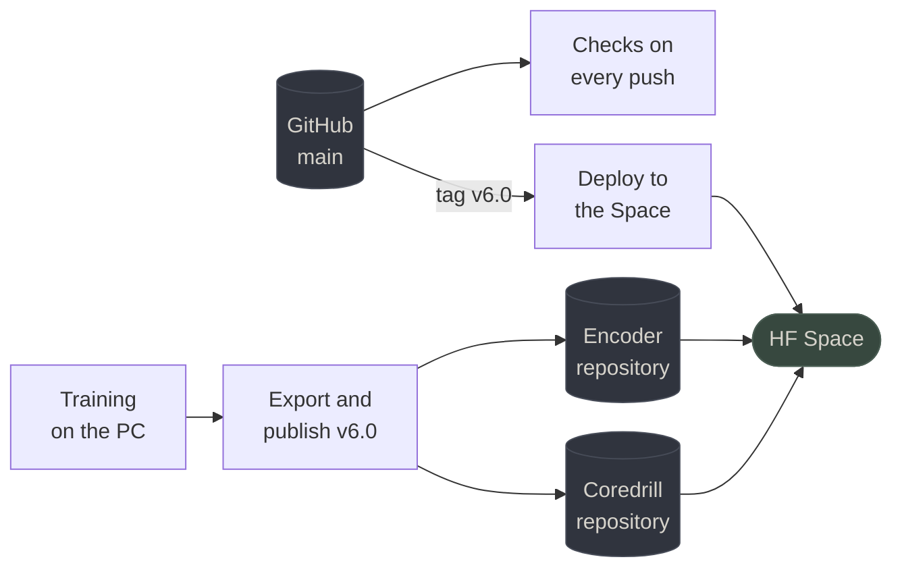

# Releases

GitHub holds the code, Hugging Face runs the API and keeps the models. This is
what connects them.



| Where | What | Who changes it |
|---|---|---|
| GitHub `main` | All code and documentation | You |
| HF Space `LCapy/coredrill` | The API, exactly as in this repository | `deploy_space.yml` |
| HF model `LCapy/coredrill-encoder` (private) | The trained encoder, one tag per version | `scripts/publish_model.py` |
| HF dataset `LCapy/coredrill-data` | `coredrill_hierarchical.json`, one tag per version | `scripts/publish_model.py` |

## GitHub Actions

| Workflow | Runs | Needs |
|---|---|---|
| `ci.yml`, Checks | On every push and pull request | Nothing |
| `deploy_space.yml`, Deploy to the HF Space | When a tag `v*` is pushed, or from the Actions tab (a dry run unless you untick the box) | `HF_DEPLOY_TOKEN` |
| `keep_alive.yml`, Keep HF Space Awake | Daily, or from the Actions tab | `HF_SPACE_URL`, `HF_TOKEN` |

Two tokens, so that the one used every day cannot change anything:

- `HF_TOKEN`: read access to the Space. The keep-awake check uses it.
- `HF_DEPLOY_TOKEN`: write access to the Space, and only to it.

To approve each deploy by hand, add yourself as a reviewer of the environment
`hugging-face` (Settings > Environments).

## Releasing a model

1. Train until there is a champion worth releasing ([training.md](training.md)).
2. Export it: `python -m train export --out exports/v6.0 --model-id LCapy/coredrill-encoder`
3. See what would be uploaded: `python scripts/publish_model.py exports/v6.0 --version v6.0`
4. Upload it: the same with `--run runs/<champion> --publish`, after `hf auth login` with a
   token that may write to the two repositories. A version is never replaced.
5. Switch the Space: set its variables `MODEL_NAME` to `LCapy/coredrill-encoder` and
   `HF_DATASET_REVISION` to `v6.0` (both at once: an encoder only works with its own
   coredrill), give its secret `HF_TOKEN` read access to both repositories, and restart it.
6. Check it: `/health` names the model, and `tests/run_eval.py` scores it.

To go back, set the two variables to the earlier version.

## Releasing code

```bash
git tag v6.0
git push origin v6.0
```

or the Actions tab: first with the dry-run box ticked, which lists the files
that would change on the Space, then without it.
